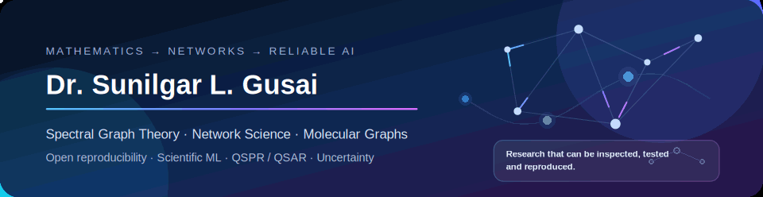
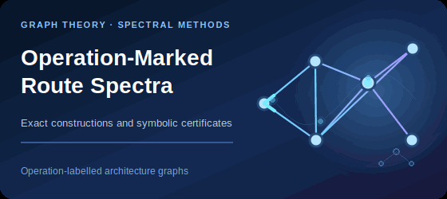
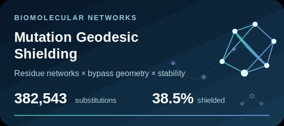
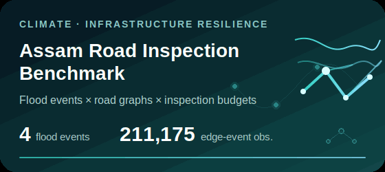
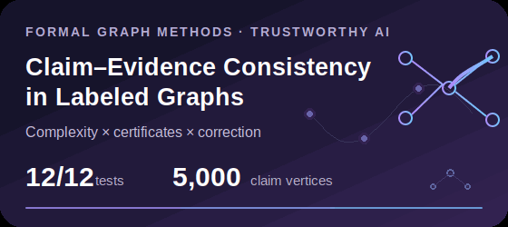
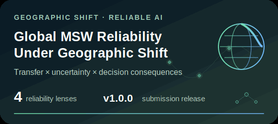
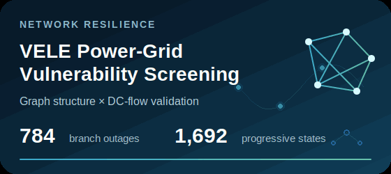
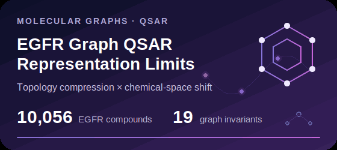
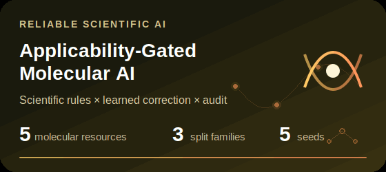
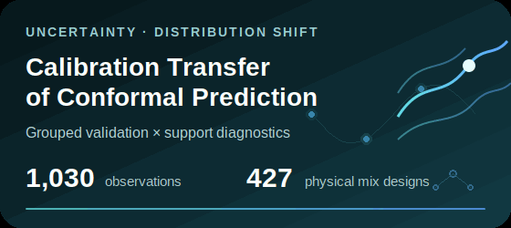

  

  <a href="https://sunilgargusai.github.io/sunilgar-portfolio/">Website</a> ·
  <a href="https://sunilgargusai.github.io/sunilgar-portfolio/assets/CV_DR_Sunilgar_L_Gusai.pdf">Curriculum vitae</a> ·
  <a href="https://orcid.org/0009-0004-0739-4812">ORCID</a> ·
  <a href="https://www.scopus.com/authid/detail.uri?authorId=60059223900">Scopus</a> ·
  <a href="https://linkedin.com/in/dr-sunilgar-gusai">LinkedIn</a>

<!-- ACADEMIC_SYNC:PROFILE_ROLE:START -->

  <b>Assistant Professor of Mathematics · Program Head, Data Science Programs · Ph.D. · Graph Theorist · Computational Researcher</b>

<!-- ACADEMIC_SYNC:PROFILE_ROLE:END -->

## About me

I am a mathematician and an Assistant Professor at Marwadi University, Rajkot. My research began in **spectral graph theory**, particularly graph energy, eccentricity-based invariants and structural questions about graphs. I continue to work on these mathematical problems while exploring their connections with complex networks, molecular structures and data-driven scientific models.

I enjoy research that brings together a precise mathematical question and a careful computational investigation. In my collaborative work, I value clear proofs, reproducible experiments and an equally clear account of what the evidence does—and does not—establish.

## Research interests

- **Graph theory and spectral methods.** I study graph energy, eccentricity-related matrices and invariants, extremal problems, and structural and algorithmic questions.
- **Networks and resilience.** I investigate how network structure relates to vulnerability, edge failure and decisions in infrastructure systems.
- **Molecular and biomolecular graphs.** My work includes molecular graph descriptors, structure–property modelling and residue-network geometry.
- **Scientific machine learning.** I am interested in how uncertainty, representation limits and the quality of evidence affect the reliability of computational conclusions.

## Research projects

My publicly available research materials span four related areas: graph theory, network systems, molecular and biomolecular graphs, and scientific machine learning. These repositories include mathematical results, computational experiments and reproducibility materials.

### Featured mathematical research

  

I study how operation-labelled directed architectures can have indistinguishable ordinary route spectra while differing under eccentricity-weighted route operators. The [research repository](https://github.com/SunilgarGusai/operation-marked-route-spectra) contains exact mathematical constructions and verification materials.

### Selected research programmes

<table>
<tr>
<td width="50%" valign="top" align="center"> Residue-network geometry around mutations</td>
<td width="50%" valign="top" align="center"> Flood-road inspection and transfer evaluation</td>
</tr>
<tr>
<td width="50%" valign="top" align="center"> Graph-theoretic consistency and verification</td>
<td width="50%" valign="top" align="center"> Geographic transfer and predictive reliability</td>
</tr>
<tr>
<td width="50%" valign="top" align="center"> Graph spectra and electrical vulnerability</td>
<td width="50%" valign="top" align="center"> Representation limits of molecular descriptors</td>
</tr>
<tr>
<td width="50%" valign="top" align="center"> Scientific rules and applicability under shift</td>
<td width="50%" valign="top" align="center"> Uncertainty calibration across composition regimes</td>
</tr>
</table>

<!-- ACADEMIC_SYNC:PROFILE_PUBLICATIONS:START -->
## Publications

- [Reciprocal Irregularity Under Partial Edge Subdivision](https://www.multiresearchjournal.com/arclist/list-2026.6.5/id-7021). *International Journal of Advanced Multidisciplinary Research and Studies*, 6(5), 1336–1341, September–October 2026.
- [Edge Failure Sensitivity of Wiener and Harary Indices in Classical Network Graphs](https://doi.org/10.56975/ijsdr.v11i9.311920). *International Journal of Scientific Development and Research*, 11(9), b394–b402, September 2026.
- [Explainable Machine Learning for Real-Time Cyber Threat Detection: An Intelligent Framework for Adaptive Information Security](https://doi.org/10.1922/comdem.v3i5S.18726). *Computer and Decision Making: An International Journal*, 3(5S), 89–102, October 2026. [Scopus record](https://www.scopus.com/record/display.uri?eid=2-s2.0-105053835294).
- [Eccentricity-Based Bounds for the Spectral Radius of Graph Matrices](https://doi.org/10.21275/SR26109233300). *International Journal of Science and Research*, Vol. 15, pp. 681–686, 2026.
- [On Vertex Eccentricity Labeled Energy of a Graph](https://doi.org/10.14419/qtfv0860). *International Journal of Basic and Applied Sciences*, 14(4), 339–350, 2025.

For additional publication details, please see my [academic CV](https://sunilgargusai.github.io/sunilgar-portfolio/assets/CV_DR_Sunilgar_L_Gusai.pdf).
<!-- ACADEMIC_SYNC:PROFILE_PUBLICATIONS:END -->

## Teaching and academic responsibilities

<!-- ACADEMIC_SYNC:PROFILE_TEACHING_ROLE:START -->
At Marwadi University, I also serve as Program Head, Data Science Programs and Area Chair — Advanced Computing. These responsibilities complement my work in teaching, mentoring and research.
<!-- ACADEMIC_SYNC:PROFILE_TEACHING_ROLE:END -->

My teaching includes **Linear Algebra, Calculus, Discrete Mathematics, Probability, Statistics, Operations Research and Applied Mathematics**. I am particularly interested in helping students connect mathematical foundations with real computational problems.

## Collaboration

I welcome academic collaborations in graph theory, network science, mathematical chemistry, scientific computing and related areas where complementary expertise can lead to meaningful results.

**Contact:** [dr.sunilgargusai@gmail.com](mailto:dr.sunilgargusai@gmail.com) · [Marwadi University profile](https://marwadiuniversity.irins.org/profile/521348)
